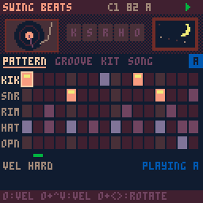

# swing_pico8

[](https://github.com/santiago-giordano/swing_pico8/actions/workflows/ci.yml) [](https://github.com/santiago-giordano/swing_pico8/releases/latest) [](LICENSE)

*[Leer en español](README.es.md)*

Four PICO-8 carts for making and recording **lofi beats in stems**, built for handhelds (tested layout: Anbernic RG CubeXX, 1:1 screen):

| Cart | What it does |
|---|---|
| `swing_beats.p8` | Drums over PCM: 5 tracks, sample-accurate swing (MPC and Dilla-style per-track grooves), per-track nudge, 4 kits, per-track start trim, one polyrhythmic track, tone/drive/room/crush |
| `swing_keys.p8` | Bass, lead and chords written as scale degrees; per-instrument reverb, filter, detune, tape wobble, tempo-synced echo |
| `swing_noise.p8` | Ambience over PCM: vinyl, tape, rain, fire, sea, night; presets, kick-synced ducking, fades, needle drop/lift |
| `swing_mix.p8` | Plays the three parts together to hear the whole song, with level, mute and solo per stem; can also record the mix |

All four share one **song file**: tempo, swing, key, scale and the arrangement. Each cart records its own stem, starting with a 1-bar click count-in, so the takes line up in your DAW.

**Get it on [itch.io](https://giordams.itch.io/swing-lofi)** · **[1-minute preview on YouTube](https://www.youtube.com/watch?v=n9OyCdPD6Is)** (the four carts playing, one after another)


## Listen



Rendered with the test rig (same PCM path as official PICO-8), default song at 82 BPM:

- [Full mix, "drunk" groove](docs/audio/5_mezcla_borracho.mp3): beats + keys + noise stems summed
- Drums only, same pattern, four grooves:
  [MPC 62%](docs/audio/1_mpc62_sin_groove.mp3) ·
  [septuplet](docs/audio/2_septillo.mp3) ·
  [snare 5/192 early](docs/audio/3_snare_5-192.mp3) ·
  [drunk](docs/audio/4_borracho.mp3)

The differences between grooves are 20–70 ms: use headphones and play them back to back.

<br clear="right">

## Install

Download the zip from the [latest release](https://github.com/santiago-giordano/swing_pico8/releases/latest) (or clone the repo). Copy one language folder to your PICO-8 carts folder (`roms/pico8` on Knulli):

- `carts/en/`: starts in English
- `carts/es/`: starts in Spanish

You can switch language in either version: press **X** on the song picker.

### Images and videos in the game list (Knulli / Batocera)

The `knulli/` folder has the metadata so the four carts show up with a description, screenshot and video in the PICO-8 list:

1. Copy `knulli/images/` and `knulli/videos/` into `roms/pico8/` (you get `roms/pico8/images/…` and `roms/pico8/videos/…`).
2. If you have **no** `roms/pico8/gamelist.xml`, copy `knulli/gamelist.en.xml` there and rename it to `gamelist.xml` (`gamelist.xml` is the Spanish one).
3. If you **already** have one (from scraping other games), open it and paste the four `<game>…</game>` blocks before `</gameList>`.
4. Start → *Game Settings → Update Gamelists*.

Do it with the Knulli UI closed, or restart it afterwards: EmulationStation rewrites the gamelist when it exits.

### Which PICO-8?

| Runtime | beats | keys | noise | mix |
|---|---|---|---|---|
| Official PICO-8 (0.2.4+) | full (PCM) | full | full | full |
| fake-08 (Knulli's default) | "chip" fallback | full | no sound | no sound (shows a warning) |

The drums and the ambience use PICO-8's PCM channel (`serial(0x808)`), which fake-08 does not implement. On Knulli you can install the official PICO-8 from *Device Settings → Install Pico-8* and select **LEXALOFFLE: PICO8 OFFICIAL** as the emulator. See the [Knulli docs](https://knulli.org/systems/pico-8).

## Controls (same in all four)

This README uses PICO-8's own names, **O** and **X**. The on-screen help line shows **A** (= O) and **B** (= X) by default, which reads better on handhelds with A/B/X/Y buttons. The **btn** item on the song page switches it: *a/b*, *b/a* (swapped) or *o/x* (PICO-8 names). It only changes the text: which physical button acts as O or X is set by the emulator's controller mapping.

| Action | Input |
|---|---|
| Move cursor | D-pad |
| Act on cell / item (toggle, listen) | tap **O** |
| Adjust value | hold **O** + arrows |
| Play / stop | tap **X** |
| Change page | hold **X** + ← → |
| Pattern A–D | hold **X** + ↑ ↓ |
| Duplicate | hold **X** and tap **O**: on a pattern grid, copies the pattern into the next letter (only if that one is empty) and moves there; on a block of the song page, inserts a copy of the block after it |
| Record song, copy/paste/clear pattern, change song | Pause menu |

## Songs

- When a cart starts you pick a song (c1–c8). **Pick the same song in every cart.**
- Each song is a single cartdata file, `swingbox_cancionN.p8d.txt`, in PICO-8's `cdata` folder. Back it up or share it to move the whole song.
- On the **song** page you set BPM, swing, key, scale, arrangement length, click and play mode (loop / song). **click**: *no*; *rec* = one bar of count-in only when you record (the default); *met* = the same count-in plus a metronome on every beat while you play, never in recordings. In swing_keys the metronome shares a channel with the chords, so it can cut the chord's 7th on the beat. The arrangement has 16 blocks. Each block picks a beats pattern (top letter) and a keys pattern (bottom letter) and repeats ×1–×8. A part can be muted per block, for breaks. **fill** (swing_beats and swing_mix): on the last bar of every block that repeats ×2 or more, add an open hat on step 16 (*hat*), a snare roll on steps 13–16 (*snare*) or both; it also shows up in the recordings, and blocks that play once never get one. **poly** (swing_beats and swing_mix): one track per song (k, s, r, h or o) runs on its own grid of 12 (eighth-note triplets), 10 (eighth-note quintuplets), 14 (eighth-note septuplets) or 8 cells per bar, against the straight 16 of the others. O+←→ picks the track, O+↑↓ the grid. On the pattern page that row shows fewer, wider cells. Nudge and humanization still apply; swing, groove templates and fill do not. **ref drm** (swing_keys): plays the song's drums under the keys while you play, so you can write against the groove. It switches off while recording, so the keys stem stays clean; keys notes are delayed by the PCM latency (~100 ms) to stay in time with the drums, which needs the official PICO-8 (it does nothing on fake-08).

## Groove: Dilla-style timing

J Dilla's "drunk" feel comes from each drum voice sitting on its own grid at the same time (straight hats, rushed snare, dragging kick), with offsets that repeat identically every bar. The **groove** page of swing_beats models that:

| Control | What it does |
|---|---|
| swg / base | Song swing 50–75%. Base 16 delays the odd 16ths (MPC); base 8 delays the weak 8th (16ths in between follow). Tuplet values: 57% ≈ septuplet, 60% quintuplet, 62% ≈ golden, 66% triplet |
| sw (per track) | Own swing for each voice; `--` follows the song swing |
| nudge | Shifts a whole track −64…+60 ms (early snares fit: events are scheduled 100 ms ahead) |
| fl | Flam: a ghost hit 10/20/30 ms before every mid or hard hit |
| grv | Groove template: per-step offsets in 1/48 of a step, so they scale with tempo. **Tap O** to apply its preset (track swings, flam, humanize, drift; nudges reset to 0) |
| drift | Swing grows 0–3% per bar on swung tracks and snaps back every 4 bars |
| hum | 0–15 ms, mode **rand** (white noise), **smth** (correlated AR(1), closer to how drummers drift) or **lock** (the same micro-offsets every bar) |

Templates: none, get dis (backbeat −4/48, two late hats), septet (backbeat −1/64), 5/192 (snare 5/192 of a bar early, ≈ 69 ms at 90 BPM), quint (hats +0.4 step), golden, rush (snare −1/4 step), drunk. They are starting points to listen to, not measured Dilla values.

Keys and noise follow the song swing; the noise duck follows the kick track's timing.

## Recording through line out

1. Plug the headphone out into your interface or recorder.
2. In each cart choose *Pause → record song*. You get one bar of clicks (the first one is higher), then the arrangement plays once and stops.
3. Line the three takes up on the first click and cut the count-in. Humanize uses a per-song seed, so every take plays the same.

## Hearing everything together: swing_mix

No cart stores audio: each one saves its part of the score (steps, notes, kit, groove, levels) in the song file, and the sound is generated on play. `swing_mix` reads those three parts from the same song and plays them together. PICO-8 runs one cart at a time, so it carries the three engines inside: drums and noise over PCM, keys on the chip channels. Open the same song, press X and it plays the arrangement (or loops pattern A–D in loop mode).

- **mix** page: a fader (O+↑↓), a meter, and **M**ute / **S**olo (tap O) per stem, plus the **speaker** switch (the same one as in swing_beats: it changes the song's kick for both). Levels live in the song file, so they're kept for next time. They only affect swing_mix; the stems you record from each cart stay as they are.
- **song** page: tempo, swing, key and mode. The arrangement is read-only here; edit it in beats or keys.
- *Pause → record mix* records the full mix with the same count-in, if you want a quick bounce through line out.
- If the CPU stays above ~88 % while playing, the noise drops to half rate for the rest of that play (the mix page shows *noise 1/2*). Drums always stay at full quality.
- Keys fire once per frame, so in the mix they can land up to a frame (~16 ms) off the drums. The recorded stems are unaffected. In *rand* and *smooth* humanize modes the mix draws different micro-offsets than the stems, with the same character; *lock* mode matches exactly.

## The carts in detail

<details><summary>swing_beats</summary>

- **pattern**: kik / snr / rim / hat / opn, 16 steps, velocities ghost / mid / hard. O+←→ rotates the row.
- **groove** (Dilla-style microtiming, see [Groove](#groove-dilla-style-timing) above): song swing 50–75% on a 16th or 8th base, per-track swing, per-track nudge −64…+60 ms, flam, level, 8 groove templates/presets, phrase drift and three humanize modes.
- **kit**: dusty / soft / tape / boom kits (synthesized at load; *boom* has a punchier kick and snare in the mids), tune, tone (low-pass), drive, room, crush. Also an engine switch (pcm / chip), a **speaker** switch and a CPU meter. **trim** (one value per track, 0–3, about 3 ms per step) skips the first part of the sound, so the attack lands earlier and tighter; use it with nudge to place sounds with a soft attack.
- Stopping always ends in silence: once the voices and the room tail have died out the room buffers are cleared.
- **speaker** (on by default) adds a short mid-range knock and saturation to the kick, so it still reads as a kick on a handheld's small speaker, which can't play its 50–160 Hz body. Turn it off for a rounder kick on headphones or line out.
- The PCM engine schedules hits at sample level (5512.5 Hz): measured swing and nudge error is under 1 ms.
</details>

<details><summary>swing_keys</summary>

- Rows **bas / led / chd**. Bass and lead hold scale degrees 1–14 (two octaves). Chords take degrees 1–7 and are built as diatonic 7th chords with a shell voicing (3rd + 7th), and the chord name is shown (Am7, D7…). **x** cuts the note.
- **sound** page, per instrument: wave, octave, level, reverb, filter, detune, wobble (vibrato), nudge (−64…+60 ms, e.g. a bass laid back behind the kick). The lead also has a dotted-eighth echo (0–2 repeats) and chords have a slow or fast attack. The bass column also has a **speaker** switch (on by default): bass notes below E3 (~160 Hz) go up an octave, since a handheld speaker can't play them. Turn it off for line out. In swing_mix the bass follows the mix page's speaker switch.
</details>

<details><summary>swing_noise</summary>

- **scene**: six layers, each 0–7, and 8 presets (vinyl, cassette, rain, storm, campfire, beach, night, dream).
- **fx**:
  - duck: dips the ambience on every kick of the beats pattern.
  - fade in / fade out, in bars.
  - needle drop at the start and needle lift at the end.
  - master level.
</details>

## Development

```
python3 build.py          # src/*.lua -> carts/{es,en}/*.p8; fails if a cart exceeds PICO-8 limits
bash tests/setup.sh       # builds fake-08 (libretro) + a headless frontend
bash tests/run_all.sh     # build + every test below
python3 tools/media.py    # regenerates knulli/ (scraper images, videos, gamelist)
python3 tests/test_timing.py   # swing & nudge accuracy from rendered audio
python3 tests/test_groove.py   # per-track swing, templates, flam, drift, humanize modes
python3 tests/test_sync.py     # records the 3 stems and checks they line up
python3 tests/test_live_edit.py   # editing kit/tune while playing must not crash
python3 tests/test_mix.py      # swing_mix: keys vs drums alignment, mute/solo, record mix
python3 tests/screens.py       # screenshots of every page -> docs/
```

- CI (GitHub Actions) runs the build check and all tests on every push. Pushing a `v*` tag publishes a release with the carts zip and the matching CHANGELOG entry.
- `src/core.lua` is shared by the four carts. It has the song storage, sequencer, audio clock, input, pages and lofi palette. Each cart adds its own engine on top.
- The tests run the carts in [fake-08](https://github.com/jtothebell/fake-08) with a **test-only patch** that adds the PCM channel (`tests/fake08-test.patch`). This lets the harness render the official-PICO-8 sound path to WAV and measure it.
- Song file layout, 256 bytes: `0` magic, `2` bpm, `3` swing, `4` key, `5` scale, `6` seed, `7` length, `8` click (0 no, 1 count-in, 2 count-in + metronome), `9` groove template, `10` drift, `11–12` flam (2 bits per track), `13` bit 0 swing base and bits 6–7 button labels, `14–15` swing_mix levels / mute / solo, `16–31` arrangement, `32–127` beats, `128–239` keys (byte 239: bits 0–1 echo, 2 slow chords, 5 bass speaker (0 = on), 6 drum reference, 7 initialised), `1` bits 1–2 fill, bits 3–5 poly track (0 none, 1–5), bits 6–7 poly grid; `12` bits 2–7 and `13` bits 2–5 trim (2 bits per track), `13` bit 0 swing base, `240–255` noise.

### Notes

- fake-08 resolves a missing table field to the global variable with the same name. The code avoids field names that collide with globals.
- CPU: on an Anbernic RG CubeXX (Knulli, official PICO-8) swing_beats measured about 35–40% while playing. swing_noise is still an estimate (22–46% with every layer at maximum). The kit and fx pages have a CPU meter.
- PICO-8 PCM is 8-bit at 5.5 kHz. That's part of the lofi sound.

## License

[MIT](LICENSE). `tests/fake08-test.patch` modifies [fake-08](https://github.com/jtothebell/fake-08), which is also MIT-licensed. PICO-8 is a product of Lexaloffle Games; this project is not affiliated with them.
