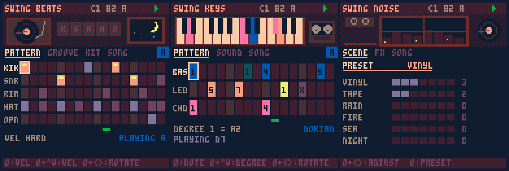

# swing_pico8

*[Leer en español](README.es.md)*

Three PICO-8 carts for making and recording **lofi beats in stems**, built for handhelds (tested layout: Anbernic RG CubeXX, 1:1 screen):

| Cart | What it does |
|---|---|
| `swing_beats.p8` | Drums over PCM: 5 tracks, sample-accurate MPC-style swing, per-track nudge, 3 kits, tone/drive/room/crush |
| `swing_keys.p8` | Bass, lead and chords written as scale degrees; per-instrument reverb, filter, detune, tape wobble, tempo-synced echo |
| `swing_noise.p8` | Ambience over PCM: vinyl, tape, rain, fire, sea, night; presets, kick-synced ducking, fades, needle drop/lift |

All three share one **song file**: tempo, swing, key, scale and the arrangement. Each cart records its own stem, starting with a 1-bar click count-in, so the takes line up in your DAW.



## Install

Copy one language folder to your PICO-8 carts folder (`roms/pico8` on Knulli):

- `carts/en/`: starts in English
- `carts/es/`: starts in Spanish

You can switch language in either version: press **X** on the song picker.

### Which PICO-8?

| Runtime | beats | keys | noise |
|---|---|---|---|
| Official PICO-8 (0.2.4+) | full (PCM) | full | full |
| fake-08 (Knulli's default) | "chip" fallback | full | no sound |

The drums and the ambience use PICO-8's PCM channel (`serial(0x808)`), which fake-08 does not implement. On Knulli you can install the official PICO-8 from *Device Settings → Install Pico-8* and select **LEXALOFFLE: PICO8 OFFICIAL** as the emulator. See the [Knulli docs](https://knulli.org/systems/pico-8).

## Controls (same in all three)

| Action | Input |
|---|---|
| Move cursor | D-pad |
| Act on cell / item (toggle, listen) | tap **O** |
| Adjust value | hold **O** + arrows |
| Play / stop | tap **X** |
| Change page | hold **X** + ← → |
| Pattern A–D | hold **X** + ↑ ↓ |
| Record song, copy/paste/clear pattern, change song | Pause menu |

## Songs

- When a cart starts you pick a song (c1–c8). **Pick the same song in the three carts.**
- Each song is a single cartdata file, `swingbox_cancionN.p8d.txt`, in PICO-8's `cdata` folder. Back it up or share it to move the whole song.
- On the **song** page you set BPM, swing, key, scale, arrangement length, count-in click and play mode (loop / song). The arrangement has 16 blocks. Each block picks a beats pattern (top letter) and a keys pattern (bottom letter) and repeats ×1–×8. A part can be muted per block, for breaks.

## Recording through line out

1. Plug the headphone out into your interface or recorder.
2. In each cart choose *Pause → record song*. You get one bar of clicks (the first one is higher), then the arrangement plays once and stops.
3. Line the three takes up on the first click and cut the count-in. Humanize uses a per-song seed, so every take plays the same.

## The carts in detail

<details><summary>swing_beats</summary>

- **pattern**: kik / snr / rim / hat / opn, 16 steps, velocities ghost / mid / hard. O+←→ rotates the row.
- **groove**: swing 50–75%, humanize 0–15 ms, per-track nudge ±40 ms and level.
- **kit**: dusty / soft / tape kits (synthesized at load), tune, tone (low-pass), drive, room, crush. Also an engine switch (pcm / chip) and a CPU meter.
- The PCM engine schedules hits at sample level (5512.5 Hz): measured swing and nudge error is under 1 ms.
</details>

<details><summary>swing_keys</summary>

- Rows **bas / led / chd**. Bass and lead hold scale degrees 1–14 (two octaves). Chords take degrees 1–7 and are built as diatonic 7th chords with a shell voicing (3rd + 7th), and the chord name is shown (Am7, D7…). **x** cuts the note.
- **sound** page, per instrument: wave, octave, level, reverb, filter, detune, wobble (vibrato), nudge. The lead also has a dotted-eighth echo (0–2 repeats) and chords have a slow or fast attack.
</details>

<details><summary>swing_noise</summary>

- **scene**: six layers, each 0–7, and 8 presets (vinyl, cassette, rain, storm, campfire, beach, night, dream).
- **fx**:
  - duck: dips the ambience on every kick of the beats pattern.
  - fade in / fade out, in bars.
  - needle drop at the start and needle lift at the end.
  - master level.
</details>

## Development

```
python3 build.py          # src/*.lua -> carts/{es,en}/*.p8, prints token counts
bash tests/setup.sh       # builds fake-08 (libretro) + a headless frontend
python3 tests/test_timing.py   # swing & nudge accuracy from rendered audio
python3 tests/test_sync.py     # records the 3 stems and checks they line up
python3 tests/screens.py       # screenshots of every page -> docs/
```

- `src/core.lua` is shared by the three carts. It has the song storage, sequencer, audio clock, input, pages and lofi palette. Each cart adds its own engine on top.
- The tests run the carts in [fake-08](https://github.com/jtothebell/fake-08) with a **test-only patch** that adds the PCM channel (`tests/fake08-test.patch`). This lets the harness render the official-PICO-8 sound path to WAV and measure it.
- Song file layout, 256 bytes: `0` magic, `2` bpm, `3` swing, `4` key, `5` scale, `6` seed, `7` length, `8` click, `16–31` arrangement, `32–127` beats, `128–239` keys, `240–255` noise.

### Notes

- fake-08 resolves a missing table field to the global variable with the same name. The code avoids field names that collide with globals.
- CPU on official PICO-8 is estimated from VM instruction counts, not measured on hardware: beats 15–26%, noise 22–46% with every layer at maximum. Use the CPU meter on the kit and fx pages to check on your device.
- PICO-8 PCM is 8-bit at 5.5 kHz. That's part of the lofi sound.

## License

[MIT](LICENSE). `tests/fake08-test.patch` modifies [fake-08](https://github.com/jtothebell/fake-08), which is also MIT-licensed. PICO-8 is a product of Lexaloffle Games; this project is not affiliated with them.
